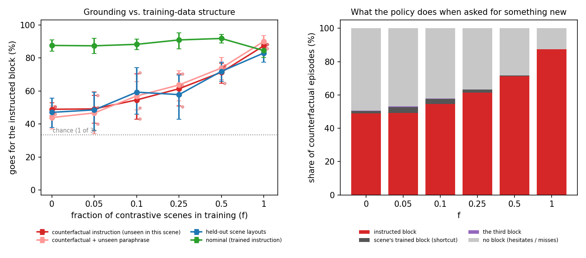
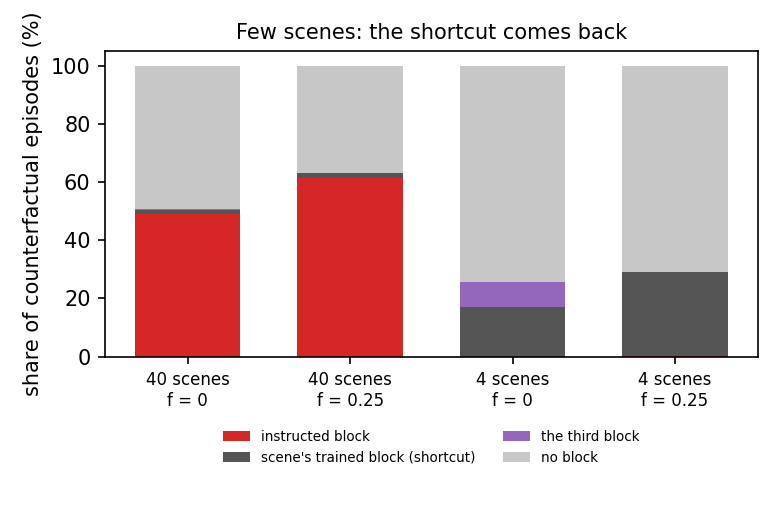

# LISTEN: When Do Robot Policies Learn to Listen?

[](https://github.com/nonberw/listen/actions/workflows/tests.yml)
[](LICENSE)
[](requirements.txt)
[](https://mujoco.org)
[](https://doi.org/10.5281/zenodo.24041281)
[](paper/main.pdf)
[](https://nonberw.github.io/listen/)
[](https://github.com/nonberw/listen/blob/prereg-39bf011/PREREGISTRATION.md)

**A controlled, pre-registered study of why language-conditioned robot policies ignore their instructions.**

[Paper (PDF)](paper/main.pdf) · [Project page](https://nonberw.github.io/listen/) · [Pre-registration](PREREGISTRATION.md) · [Overview in Russian (PDF)](docs/listen_overview_ru.pdf)



---

## The question

Vision-language-action (VLA) robot policies often ignore what you tell them. If you change the
instruction but keep the scene, they do the task they were trained on in that scene. This has been
shown repeatedly ([LIBERO-Plus](https://arxiv.org/abs/2510.13626),
[LIBERO-PRO](https://arxiv.org/abs/2510.03827), [LIBERO-CF](https://arxiv.org/abs/2602.17659),
[Encoded but Not in Control](https://arxiv.org/abs/2610.06235)). The usual explanation is the
data: each scene in a robot dataset comes with only one or a few tasks, so the image already
tells the policy what to do.

That explanation had not been tested causally, because nobody can retrain a big VLA on different
data. So we built a small world where we *can*. We train visuomotor policies from scratch, hold
the data budget, expert, architecture and recipe fixed, and change **one thing**: the fraction
`f` of *contrastive* scenes, meaning scenes demonstrated with several different instructions.

## What we found

| Contrastive scenes `f` | 0 | 0.05 | 0.1 | 0.25 | 0.5 |
|---|---|---|---|---|---|
| Follows a counterfactual instruction* | 48.9% | 49.1% | 54.6% | **61.3%** | **71.3%** |
| vs. `f = 0` (run-level bootstrap, Holm) | | p = 0.53 | p = 0.53 | **p = 0.033** | **p < 1e-4** |

\*Measured in scenes that were only ever demonstrated with *one* target in all of these conditions,
asking for a block that scene was never demonstrated with.

1. **Grounding transfers.** Contrastive data in *some* scenes makes the policy follow instructions
   in *other* scenes that never had any. Nominal skill doesn't drop.
2. **Small doses do nothing.** Two to four contrastive scenes have no detectable effect; ten do.
3. **The policies hesitate rather than stubbornly doing the trained task.** Our first pre-registered
   hypothesis failed: the trained "shortcut" block was taken in only 1.4% of counterfactual
   episodes. Instead, the gripper descends about 5 cm from the instructed block, pulled toward the
   scene's trained block, and misses.
4. **With few scenes, the familiar VLA failure comes back.** In an exploratory experiment with 4
   scenes instead of 40, counterfactual grounding drops to **0%**, the shortcut rises to 17%, and
   one contrastive scene out of four doesn't help.

The upshot: language blindness depends on whether the scene is *easier to learn* than the
language. The fix is contrastive data spread across **many** scenes. All the details, numbers
with confidence intervals and limitations are in the [paper](paper/main.pdf).



## How it was done

- **Pre-registered.** Hypotheses, metrics and the analysis plan were committed *before* any
  experiment (commit `39bf011`, tag `prereg-39bf011`). Every later change is logged in a dated "Deviations" section:
  the pilot-stage fix (temporal ensembling) and exploratory experiment E, registered before any
  main result was seen. See `git log`. The repository was published only after the experiments
  finished, so these timestamps come from the local git history and not from a public registry.
- **Controlled.** 40 scene templates with color-balanced default targets, nested contrastive
  sets, and exactly 1200 demonstrations per condition, sampled from one shared expert pool.
  `tests/test_design.py` pins all of this down.
- **Policy.** A CNN with FiLM conditioning from a frozen MiniLM sentence encoder, ACT-style action
  chunking with temporal ensembling, and a 64x64 camera. The arm, IK and gripper come from the
  author's [ARMageddon](https://github.com/nonberw/armageddon) and [YOINK](https://github.com/nonberw/yoink).
- **Evaluation.** 660 fixed episodes per run, 3 seeds per condition, 24 runs in total plus the pilot.
  Two-level bootstrap CIs, run-level tests with Holm correction, and the pre-registered logistic
  regression.
- **Everything is reported**, including the hypotheses that failed (H1, E2) and the places where
  the two statistical tests disagree.

## Reproduce

```bash
pip install -r requirements.txt
```

```bash
python scripts/build_pool.py
```

```bash
python scripts/run_sweep.py --seeds 0 1 2
```

```bash
python scripts/build_pool.py --few
```

```bash
python scripts/run_sweep.py --regime few --fractions 0 0.25 --seeds 0 1 2
```

```bash
python scripts/analyze.py
```

The whole thing takes about 4 hours on a laptop (RTX 3050 Ti + 20 CPU threads). Per-episode
records for every run are already in `runs/*/episodes.json`, so `python scripts/analyze.py`
reproduces every number and figure in the paper without retraining anything. Model weights
(184 MB) are not included and can be regenerated with the commands above.

```bash
python -m pytest
```

## Layout

```
PREREGISTRATION.md   hypotheses, metrics, analysis plan, dated deviations
listen/
  env.py             MuJoCo pick-up scene, 10 Hz end-effector control, commit/lift detection
  expert.py          scripted expert with privileged state (+ DART noise during collection)
  design.py          scenes, balanced default targets, nested contrastive sets, instructions
  data.py            demonstration pool
  policy.py          FiLM-CNN policy, action chunks, temporal ensembling, augmentation
scripts/             build_pool, train, evaluate, run_sweep, analyze, freeze_analysis
runs/                per-episode evaluation records for every run (weights not included)
results/             summary.json, figures, failure analysis
paper/               LaTeX source and PDF
docs/                project page (index.html, figs/) and an overview of the idea (Russian)
```

## Cite

```bibtex
@misc{zhambakin2026listen,
  author       = {Zhambakin, Anuar},
  title        = {When Do Robot Policies Learn to Listen? A Controlled, Pre-Registered
                  Study of Training-Data Structure and Language Grounding},
  year         = {2026},
  howpublished = {Preprint},
  doi          = {10.5281/zenodo.24041281},
  url          = {https://github.com/nonberw/listen}
}
```

## License

[MIT](LICENSE)
